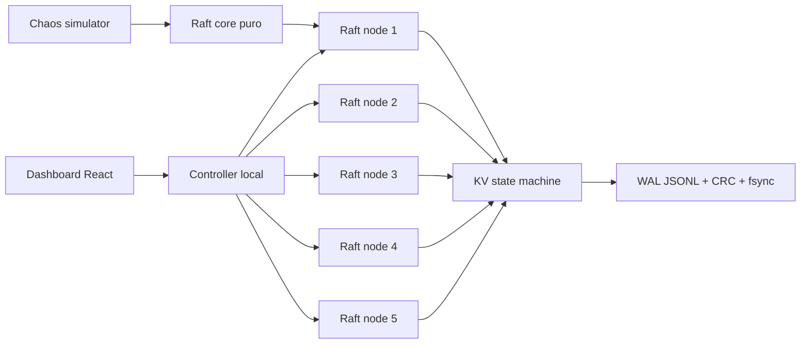

# Raft Consensus Lab

Laboratório de engenharia para estudar consenso distribuído com um cluster Raft real,
uma máquina de estados chave-valor, persistência WAL, cliente, simulador determinístico
e dashboard operacional.

## O que existe hoje

- Núcleo Raft determinístico em [`packages/raft-core`](./packages/raft-core), com eleição,
  votos, heartbeats, replicação e avanço de commit.
- Nó KV em [`packages/node`](./packages/node), com PUT, GET, DELETE, CAS, idempotência e
  WAL JSON Lines com checksum.
- Cliente em [`packages/client`](./packages/client), com redirecionamento ao líder, retry
  e backoff.
- Simulador determinístico em [`packages/chaos`](./packages/chaos), com relógio virtual,
  seed, falhas de rede e verificação de invariantes.
- Controller local e dashboard em [`packages/dashboard`](./packages/dashboard).
- Métricas Prometheus e benchmark closed-loop com percentis medidos.

O cluster de desenvolvimento usa cinco nós lógicos dentro do controller local. O estado
é real dentro do processo, mas esse modo ainda não substitui uma topologia distribuída
com cinco processos independentes.

## Início rápido

```bash
npm install
npm run cluster:dev
npm --workspace @raft/dashboard run dev
```

O controller local fica em `http://127.0.0.1:1098` e o dashboard em `http://localhost:5173`.
Quando o controller não estiver disponível, o dashboard mostra explicitamente
`cluster não está rodando`.

## Simulador reproduzível

```bash
npm run sim -- --seed 42 --scenario isolated-leader
```

Cenários disponíveis: `isolated-leader`, `majority-loss`, `symmetric-partition`,
`cascading-restart` e `client-retry`.

## Benchmark

O benchmark mede apenas chamadas que realmente executa. Não há números fixos no código:

```bash
npm run benchmark -- --url http://127.0.0.1:1098 --concurrency 4 \
  --warmup 100 --repetitions 1000 --write-ratio 50 --format markdown \
  --output benchmark.md
```

O relatório registra host, alvo, metodologia, contagens e p50/p90/p95/p99. Resultados
devem ser comparados somente quando a máquina, configuração e metodologia forem iguais.

## Arquitetura



## Como verificamos a correção

- Testes unitários do núcleo cobrem eleição, voto, conflito de log e commit.
- O simulador usa seed e relógio virtual para repetir cenários.
- `fast-check` gera seeds para testar estabilidade e invariantes.
- O verificador de linearizabilidade trabalha por chave e possui históricos válidos
  e inválidos construídos manualmente.

Comandos de validação:

```bash
npm run lint
npm run typecheck
npm test
npm run build
```

## Limitações conhecidas

- O controller local mantém cinco nós no mesmo processo; o modo de processos Docker
  independentes ainda precisa ser concluído.
- ReadIndex, snapshots e InstallSnapshot estão em implementação.
- O dashboard já tem o shell operacional, mas as páginas de caos, replay, benchmark e
  consistência ainda precisam ser ligadas a todos os endpoints.
- O benchmark não deve ser interpretado como resultado publicado sem especificação completa
  da máquina e execução documentada.

## Estrutura

| Pacote | Responsabilidade |
| --- | --- |
| `packages/raft-core` | Máquina de consenso pura |
| `packages/node` | Nó, KV, WAL, HTTP e observabilidade |
| `packages/client` | Cliente KV com retry |
| `packages/chaos` | Simulação, controller e benchmark |
| `packages/dashboard` | Console web do cluster |

Veja as decisões em [`docs/adr`](./docs/adr).
