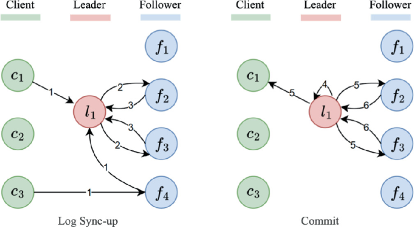

# Visão Geral do Algoritmo Raft

## Introdução

Raft é um algoritmo de consenso projetado para ser mais compreensível que o Paxos, mantendo a mesma eficácia. Ele resolve o problema fundamental de consenso em sistemas distribuídos: fazer um conjunto de máquinas concordarem sobre um valor ou sequência de operações, mesmo quando algumas falham.

## Documentação Oficial

Para informações completas e formais sobre o algoritmo, consulte: [https://raft.github.io/](https://raft.github.io/)

---

## Conceitos Fundamentais

### Estados de um Nó

Cada nó no cluster Raft pode estar em um de três estados:

- **Follower**: Estado inicial e padrão. Responde a requisições de Leaders e Candidates
- **Candidate**: Estado transitório durante eleição. Solicita votos para se tornar Leader
- **Leader**: Gerencia todas as interações com clientes e coordena replicação de logs

### Termos

O tempo no Raft é dividido em termos (terms) de duração arbitrária. Cada termo:

- Inicia com uma eleição
- Possui um número sequencial crescente
- Pode ter no máximo um líder
- Serve como relógio lógico do sistema

---

## Mecanismo de Funcionamento



### 1. Eleição de Líder

#### Início da Eleição

Um Follower se torna Candidate quando seu timeout de eleição expira sem receber heartbeat do líder:

1. Incrementa seu termo atual
2. Vota em si mesmo
3. Envia requisições RequestVote para todos os outros nós
4. Aguarda resposta da maioria

#### Regras de Votação

Um nó concede seu voto para um Candidate se:

- Ainda não votou neste termo
- O termo do Candidate é maior ou igual ao seu
- O log do Candidate está pelo menos tão atualizado quanto o seu

#### Resultados Possíveis

- **Vitória**: Recebe votos da maioria → torna-se Leader
- **Derrota**: Outro nó vence → volta a Follower
- **Empate**: Timeout expira → nova eleição com termo incrementado

### 2. Replicação de Logs

#### Estrutura do Log

Cada entrada de log contém:

```
{
  index: número sequencial
  term: termo em que foi criada
  command: operação a ser executada
  timestamp: momento da criação
  status: Pending | Committed | Applied
}
```

#### Processo de Replicação

1. **Cliente envia comando** → Leader recebe requisição
2. **Leader adiciona ao log** → Entrada marcada como Pending
3. **Leader envia AppendEntries** → Broadcast para todos Followers
4. **Followers replicam** → Gravam entrada em seus logs
5. **Maioria confirma** → Leader marca como Committed
6. **Leader responde cliente** → Operação confirmada
7. **Aplicação gradual** → Entries são aplicadas à máquina de estados

#### Garantias de Consistência

- **Log Matching**: Se duas entradas em logs diferentes têm mesmo índice e termo, armazenam o mesmo comando
- **Leader Completeness**: Se uma entrada foi committed em um termo, ela estará presente no log de todo líder de termos futuros
- **State Machine Safety**: Se um nó aplicou uma entrada no índice i, nenhum outro nó aplicará comando diferente para i

### 3. Segurança e Recuperação

#### Heartbeats

O Leader envia AppendEntries vazio periodicamente para:

- Manter autoridade
- Prevenir novas eleições
- Detectar falhas de nós

#### Recuperação de Inconsistências

Quando um Follower possui log inconsistente:

1. Leader encontra último ponto de concordância
2. Leader sobrescreve entradas divergentes do Follower
3. Leader envia todas as entradas faltantes
4. Follower replica e confirma

#### Eleição com Restrições

Para preservar entradas committed, Raft restringe quais nós podem ser eleitos:

- Candidate deve ter todas as entradas committed
- Verificado comparando índice e termo da última entrada
- Voters negam voto se seu log for mais atualizado

---

## Tolerância a Falhas

### Falhas de Nós

O cluster permanece operacional se a maioria dos nós estiver funcional:

- **Cluster de 3 nós**: Tolera 1 falha
- **Cluster de 5 nós**: Tolera 2 falhas
- **Cluster de 2N+1 nós**: Tolera N falhas

### Partições de Rede

Em caso de partição:

- **Partição majoritária**: Continua operando normalmente
- **Partição minoritária**: Não pode eleger líder, apenas leituras obsoletas possíveis
- **Reunificação**: Nós minoritários se atualizam automaticamente

### Falha do Líder

1. Followers detectam ausência de heartbeat
2. Timeouts expiram de forma escalonada
3. Primeiro Follower inicia eleição
4. Novo líder eleito rapidamente (tipicamente < 1s)
5. Operações retomadas automaticamente

---

## Otimizações Implementadas

### Log Compaction

Logs crescem indefinitamente. A solução implementada:

- Snapshots periódicos do estado
- Descarte de entradas antigas
- Transferência de snapshots para nós atrasados

### Pipelining

Para melhorar throughput:

- Leader envia múltiplas AppendEntries sem aguardar confirmação
- Followers processam em paralelo
- Reduz latência em redes de alta latência

### Batch Processing

Otimização de escrita:

- Agrupa múltiplos comandos em uma entrada
- Reduz overhead de replicação
- Aumenta throughput em cargas pesadas

---

## Comparação com Outros Algoritmos

| Característica | Raft | Paxos | Multi-Paxos |
|----------------|------|-------|-------------|
| Compreensibilidade | Alta | Baixa | Média |
| Eleição de Líder | Explícita | Implícita | Explícita |
| Log Estruturado | Sim | Não | Sim |
| Implementação | Direta | Complexa | Complexa |
| Performance | Comparável | Comparável | Comparável |

---

## Casos de Uso

### Aplicações Práticas

- **Bancos de Dados Distribuídos**: CockroachDB, TiDB
- **Sistemas de Configuração**: etcd, Consul
- **Orquestração**: Kubernetes (etcd)
- **Filas Distribuídas**: Apache Kafka
- **Coordenação de Microserviços**: Service meshes

### Quando Usar Raft

- Sistema requer forte consistência
- Tolerância a falhas é crítica
- Simplicidade de implementação é importante
- Número moderado de nós (3-7 típico)

### Quando Não Usar Raft

- Milhares de nós no cluster
- Eventual consistency é suficiente
- Latência extremamente baixa é prioridade
- Sistema não tolera líder único

---

## Limitações

### Escalabilidade

- Performance degrada com muitos nós
- Eleições ficam mais lentas
- Bandwidth para replicação aumenta linearmente

### Líder Único

- Gargalo de escrita no líder
- Leituras podem ser servidas por followers (com trade-offs)
- Falha do líder causa indisponibilidade temporária

### Latência Geográfica

- Replicação síncrona sofre com alta latência
- Clusters geograficamente distribuídos têm desempenho reduzido
- Recomendado manter nós próximos

---

## Referências Técnicas

- [Ongaro, D., & Ousterhout, J. (2014). In Search of an Understandable Consensus Algorithm](https://raft.github.io/raft.pdf)
- [Raft Consensus Algorithm Official Site](https://raft.github.io/)
- [Visualization: The Secret Lives of Data](http://thesecretlivesofdata.com/raft/)
- [Raft GitHub Organization](https://github.com/raft)